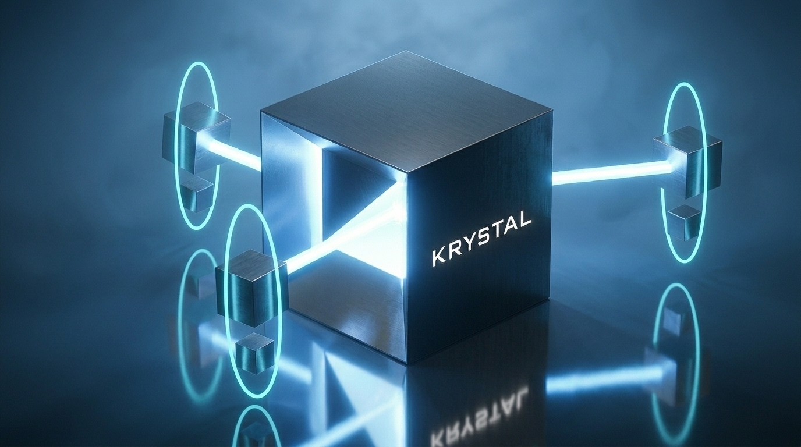

# Krystal Loop Protocol



Use fast AI agents for bounded work. Freeze the product promise and use direct
evidence to keep the project coherent, working, and under your control.

AI coding agents can produce a lot of code quickly. The harder problem begins
after the first impressive demo: agents lose context, overlap each other's
changes, trust confident summaries, reopen solved problems, and quietly break
features that worked yesterday.

Krystal Loop Protocol (KLP) is a practical operating pattern for continuing to
build with multiple AI agents without handing them control of the project.

## What You Gain

- **Less repeated explanation.** Give each agent the material needed for its
  assignment, not the whole project history. Compact packets retain the full
  mission, task requirements and required evidence.
- **Use your strongest model where it matters.** Delegate suitable bounded
  work to a lower-cost capable model while keeping planning and independent
  review. This is a model-choice option, not a promised reduction in your bill.
- **Clearer handovers.** Explicit task IDs, revisions and message types help
  agents distinguish a status update, a question and a finding. The optional
  Semio adapter checks those bindings; a message is not permission to act.
- **Less checking for updates.** An optional wake bridge can notify a
  preconfigured job when its expected event arrives, instead of repeatedly
  scanning for it. Duplicate, stale and already-attempted notifications can
  be handled before they consume another model turn.
- **A stopping point.** Shared effort budgets and repair limits keep the
  assignment bounded. Tests, independent review and capability evidence still
  matter; a smaller prompt is not an excuse to skip them.

### What We Have Measured

**Semio cut coordination input tokens by 75%, with every scenario handled
correctly.** In a four-scenario comparison against agent-managed handovers,
the optional Semio adapter reduced coordination model calls **from four to
one** and input tokens **from 5,325 to 1,331**. Both paths achieved **4/4 correct
outcomes**. The saving came from handling duplicate, stale and already-attempted
work before it reached the model, not from dropping the coding checks or review.
See the [Semio coordination case study and seven sanitized receipts](case-studies/semio-coordination-2026-10-20/README.md).

On a real coding repair from a **255-file KrystalView snapshot**, a DeepSeek
worker with frontier review cost **94.94% less for the worker** than the
conventional frontier worker. Including critics and an equal share of all
shared model evaluation, **total measured API cost was 24.64% lower**:
**$0.2709 versus $0.3595**. All final candidates passed the same 15 checks;
the conventional arm needed one review-driven repair, which is counted.
Coordinator subscription cost is unavailable and is not included as zero.
Later integration review found and corrected one additional C compatibility
gap; that subsequent work is outside the experiment's cost figures.
See the [three-way coding case study and sanitized receipts](case-studies/krystalview-2026-10-20/README.md).

One real documentation assignment used **20.99% fewer reported worker-plus-critic
input tokens** with compact packets, including repairs and review rechecks.
Both versions passed final review after one repair each. Separately, one local
wake comparison reduced transport reads from **21 to 3 (85.71%)**, with no
observed prompt-byte savings.

These are small, task-specific observations, not a guaranteed cost or quality
improvement. The percentages measure different things and must not be added
together. See [Measured benefits and limits](EVIDENCE.md) for the totals,
methods, unavailable costs and further results already recorded.

## The 90-Second Version

**Start with Standard for ordinary bounded work.** One short versioned task
record, relevant checks, one independent review plan and an evidence-backed
finish. No compulsory message bus, per-step ledger or custom stamping scripts.

**Use Critical when the consequences demand it:** save/data migrations,
security boundaries, consequential economy changes, release qualification or
anything affecting a protected core capability. Critical keeps the full
mission and capability gate below. The number of developers is not the risk test.

See [Execution Profiles](EXECUTION_PROFILES.md) and the
[one-record Standard template](examples/standard-task.md). Standard uses
`klp-standard/v0.1`; Critical retains `klp-core/v0.3`. Do not downgrade an active
Critical run or claim that Standard passed Core-only validators.

For **Critical** work:

1. **Freeze the core promise.** Store one canonical Mission Contract with its
   identity, critical capabilities, trigger rules, accepted baselines, and
   operator amendment authority.
2. **Scope it.** Bind the task to that exact mission, declare affected
   capabilities, allowed files, forbidden actions, checks, budget, and stops.
3. **Build and check it.** Workers return factual handovers; deterministic
   checks run before independent criticism.
4. **Critique and repair it.** A fresh, read-only critic is evidence-bound;
   confirmed blockers receive only bounded repairs inside the frozen contract.
5. **Integrate it.** Treat the combined system as a new artifact.
6. **Prove the core promise again.** A Capability Auditor runs approved
   product-truth controls against the exact integrated artifact. A critical
   capability that is degraded or unproven stops completion.

> Before agents change an app, prove it still does its main job. After they
> finish, prove it again. If it no longer works, the loop stops, even if every
> technical test passed.

## What This Prevents

| Common agent failure | KLP response |
| --- | --- |
| Two agents edit the same shared file. | Give each worker an explicit file and action boundary. |
| A worker says its own work is complete. | Separate factual handover from independent acceptance. |
| A critic reviews an outdated build. | Bind every verdict to an exact artifact revision. |
| A critic confidently reports a false problem. | Confirm or refute every finding with direct evidence. |
| Agents keep looping without improvement. | Stop on repeated findings, exhausted budgets, or a plateau. |
| New tooling creates more work than the requested change. | Reassess whether the tooling is necessary; simplify the approach inside delegation. |
| Unit changes pass but break when combined. | Review integration as a new artifact. |
| A test or agent message is treated as permission to deploy. | Keep live actions behind an explicit human decision. |

## Start With One Prompt

Give this to the lead agent before a multi-agent build:

```text
Work under Krystal Loop Protocol Core.
First read EXECUTION_PROFILES.md and select Standard or Critical before editing.
Record why, under the operator's request or standing authority. Never downgrade
an active Critical run or waive a required product capability to finish faster.

For ordinary bounded work with no Critical trigger, use klp-standard/v0.1 and
examples/standard-task.md: one versioned record with the product promise,
outcome, exact base/result, authorized paths, protected areas, relevant checks,
independent reviewer, and one finite time/cost/repair budget for the whole task.
Do not add Core-only paperwork, a message bus or custom stamping tooling.

For Critical work, follow PROTOCOL.md in full under klp-core/v0.3: exact Mission
Contract binding, accepted pre-work baseline, required separate roles, checks,
review and integrated-artifact capability proof. Existing offline references are
examples/fail-review-repair/README.md and
examples/capability-regression/README.md; neither certifies production safety.

In either profile, keep tests isolated from production credentials and external
network access. Give the critic relevant functions, callers, tests and evidence,
not just a diff. Confirm, refute or leave findings unresolved using direct proof;
a reviewer preference cannot invent acceptance criteria. Use an upfront bounded
adjacent-edit allowance only when authorized; otherwise respect the file boundary.

Reuse existing checks and one coordinated review plan. Reassess after two failed
cycles or when process tooling becomes the blocker. Finish when the required
evidence is satisfied; advisory notes do not require another review loop.
No profile authorizes deployment, spending, public posting or other live actions.
```

KLP does not require a special model, database, vector store, or message bus.
You can start with Git and Markdown files, then add durable coordination when
the project needs it.

## Run a Worker and Critic

The included examples demonstrate one complete bounded path:

```text
DeepSeek Flash worker
  -> exact revision and deterministic checks
  -> controller-redacted, sealed review packet
  -> different-family read-only critic
  -> evidence-backed finding dispositions
  -> bounded repair or integration
```

Start with the [DeepSeek Codex worker](examples/deepseek-codex-worker/README.md),
then use the
[OpenAI-compatible critic harness](examples/openai-compatible-critic/README.md).
The worker launcher uses an isolated Codex profile and a reviewed assignment.
The critic makes one request, validates its structured verdict locally, and
cannot edit or authorize any action. The examples do not automatically connect
worker output to critic input; the controller must inspect and redact the
review packet first.

## Run the Offline Lifecycle Proof

The [fail-review-repair fixture](examples/fail-review-repair/README.md) proves a
complete bounded lifecycle without provider egress or model spend:

```bash
output="$(mktemp -d)/klp-fixture"
python3 examples/fail-review-repair/run_fixture.py --out-dir "$output"
python3 -m json.tool "$output/final-receipt.json"
```

It creates a temporary Git project, records a deliberately incomplete worker
revision, captures a failed check, runs the sealed critic harness against a
loopback fake provider, confirms one real finding, refutes one false finding,
applies one authorized repair, and re-checks the integrated artifact. A second
test proves a zero-round repair budget stops instead of overrunning authority.

The [capability-regression fixture](examples/capability-regression/README.md)
proves the v0.3 product-truth gate. It establishes an accepted baseline,
deliberately regresses an adaptive capability while task checks pass, blocks
completion, repairs within the declared limit, and proves the repaired
integrated artifact. Both lifecycle fixtures are offline protocol examples:
neither certifies production safety.

## Read Next

- [KLP Core protocol](PROTOCOL.md)
- [Standard and Critical execution profiles](EXECUTION_PROFILES.md)
- [Compact Standard task record](examples/standard-task.md)
- [Instructions for AI agents and orchestrators](AI_AGENT_INTEGRATION.md)
- [Optional runtime profiles](RUNTIME_PROFILES.md)
- [Safety and limits](SAFETY_AND_LIMITS.md)
- [DeepSeek Codex worker example](examples/deepseek-codex-worker/README.md)
- [OpenAI-compatible critic example](examples/openai-compatible-critic/README.md)
- [Offline fail-review-repair fixture](examples/fail-review-repair/README.md)
- [Offline capability-regression fixture](examples/capability-regression/README.md)
- [Hermes Kanban adapter example](adapters/hermes-kanban.md)
- [Optional Semio agent-coordination adapter](adapters/semio.md)
- [Compact context packet guide](examples/semio-coordination/CONTEXT_PACKETS.md)
- [Measured benefits and limits](EVIDENCE.md)

## What KLP Is Not

KLP is not an autonomous software factory, deployment platform, model router,
or claim that tests prove a product has no defects. It is a portable way to
bound multi-agent work, retain useful evidence, and make uncertainty visible.

KLP is inspired by public builder/critic systems such as the
[Gauntlet Loop](https://somethingbig.ai/gauntlet-loop). It does not claim to
invent multi-agent coding, independent review, or automated testing. Its focus
is what happens after the demo, when a real project must remain understandable
and working across many changes.

## Project Status

The current package revision is **v0.3.2-draft**, a provisional public profile.
It adds explicit Standard/Critical selection, a compact Standard record and
bounded adjacent-edit guidance. Critical retains `klp-core/v0.3` unchanged.
Standard is documented as `klp-standard/v0.1`; existing validators and adapters
do not automatically accept it. No existing record is silently migrated.

This repository includes a
portable worker launcher, a sealed-packet critic harness, local fake-provider
tests, Mission Contract examples, and reproducible offline lifecycle fixtures.
The fixtures prove protocol mechanics and capability-gate behavior; they do not
certify model quality, production safety, or a particular agent framework.

## License

Krystal Loop Protocol uses split licensing:

- software, scripts, schemas, configuration examples, and tests are licensed
  under [Apache License 2.0](LICENSE-APACHE-2.0) (`Apache-2.0`);
- protocol and documentation text are licensed under
  [Creative Commons Attribution 4.0](LICENSE-CC-BY-4.0) (`CC-BY-4.0`).

See the [licensing map](LICENSE) for the file-level boundary.
