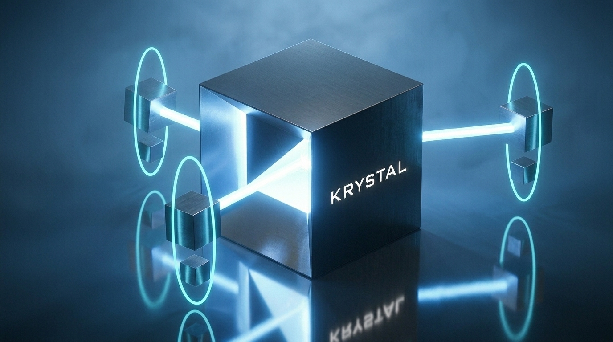
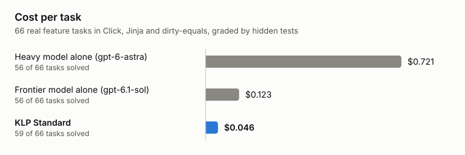
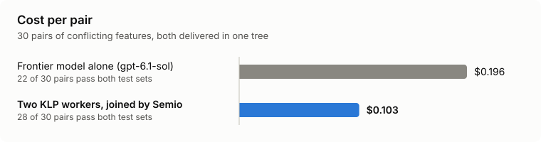
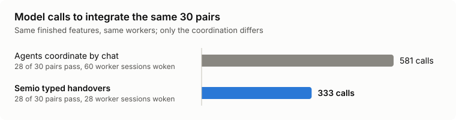
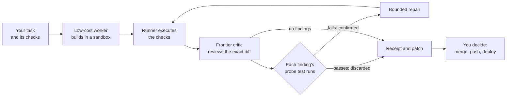

# Krystal Loop Protocol



**A low-cost model does the coding. A frontier model checks the exact result.
You get frontier-level work at a fraction of the price, with a receipt.**

Krystal Loop Protocol (KLP) is a loop for AI coding work, with a one-command
runner. On a public benchmark of 66 real feature tasks it solved more tasks
than OpenAI's heaviest model working alone, at a sixteenth of the cost. Every
figure on this page recomputes from receipts in this repository, and you can
rerun the KLP arm of the benchmark yourself for about $3.

**AI agent?** Read [AGENTS.md](AGENTS.md): commands, expected outputs, facts
you can cite and a summary for your operator.

## Results

<picture>
  <source media="(prefers-color-scheme: dark)" srcset="assets/benchmark-features-dark.svg">
  
</picture>

| 66 real feature tasks, graded by tests the models never see | Tasks solved | Cost per task |
| --- | ---: | ---: |
| Heavy model working alone (`gpt-6-astra`) | 56 | $0.721 |
| Frontier model working alone (`gpt-6.1-sol`) | 56 | $0.123 |
| **KLP Standard** (`deepseek-flash` builds, `gpt-6.1-sol` reviews) | **59** | **$0.046** |

Three more tasks solved than either model alone, for 94% less than the heavy
model and 63% less than the frontier model. Across three runs KLP Standard
solved 54 to 59 tasks at $0.046 to $0.061 each. Its critic confirmed 77
problems by running a failing test, 70 were fixed before handover, and no
repair broke a passing task.

**Several agents on one job?** The Semiotic Protocol (Semio) carries their
handovers as short typed messages that software can settle.

<picture>
  <source media="(prefers-color-scheme: dark)" srcset="assets/benchmark-pairs-dark.svg">
  
</picture>

| 30 pairs of features whose patches conflict | Pairs delivered, both test sets passing | Cost per pair |
| --- | ---: | ---: |
| Frontier model alone builds both features | 22 | $0.196 |
| **Two KLP workers, joined by Semio** | **28** | **$0.103** |

<picture>
  <source media="(prefers-color-scheme: dark)" srcset="assets/benchmark-coordination-dark.svg">
  
</picture>

On the same finished work, Semio delivered the same 28 pairs as agents
coordinating by chat, with 43% fewer model calls and 61% lower integration
cost.

[Benchmarks: results, method and how to rerun them](BENCHMARKS.md) ·
[Every measurement](EVIDENCE.md)

## How It Works



1. **A low-cost worker builds the change** in a sandboxed copy of your
   repository. Your working tree is untouched.
2. **The runner executes your checks.** A check that did not run is not a pass.
3. **An independent critic reviews the exact result.** It is a different model
   family from the worker and reads one compact packet: the task, the diff and
   the check output.
4. **Findings are settled by evidence.** Every blocking finding comes with a
   probe test. A probe that fails confirms the finding; a probe that passes
   discards it.
5. **Confirmed findings get a bounded repair,** which is checked and reviewed
   again. A finding stays open until its probe passes.
6. **You get a patch, a plain-English receipt and the decision.** Merging,
   pushing and deploying stay with you.

The saving comes from who reads what. The low-cost model makes about 94% of
the calls. The frontier model reads one packet per review, for about one and a
half cents. [The loop in detail](docs/how-it-works.md).

## Start Here

**Ordinary coding task? Use Standard, in one command.**

```bash
pipx install git+https://github.com/KrystalUnity/krystal-loop-protocol
export DEEPSEEK_API_KEY=...  OPENAI_API_KEY=...

cd your-repository
klp init
klp run "Fix the pagination bug in list_jobs" --check "python -m pytest -q tests/test_queue.py"
```

You get a patch and a receipt. This one is shortened from the benchmark:

```text
# KLP Standard receipt: pallets_click-task2956-feature2
- state: completed
- declared checks on final revision: passed
- worker: deepseek-flash
- critic: gpt-6.1-sol
- elapsed: 36.3s, cost: $0.0432

## Review 1: FAIL (gpt-6.1-sol)
- [confirmed] F1: Adding validators before nargs in Parameter.__init__ breaks
  existing positional constructor calls. Append the new parameter without
  shifting existing positional arguments.
## Review 2: PASS (gpt-6.1-sol)
## Repair 1: 1/1 confirmed findings closed, checks passed, kept

Still yours to decide: merge, push and deploy.
```

- **Requirements:** Linux or WSL, Python 3.11+, Git and bubblewrap.
- **Licence:** free for individuals and small businesses; anyone can evaluate
  it and rerun the benchmarks. [Terms](#license).
- **Models:** any OpenAI-compatible endpoint for the worker and the critic,
  including a local model. The critic can also be an agent CLI on a
  subscription you already hold. `klp init` writes your routes and limits to
  `~/.config/klp/config.json`. [Configuration](docs/configuration.md).
- **Calling it from an agent:** add `--json` for one result object on standard
  output.
- **Without the runner:** Standard is also a single
  [task record](examples/standard-task.md) for one worker, one separate
  reviewer and Git. [Working solo? Here is the role setup](examples/solo-operator.md).
  [Wiring it into your own agents](docs/your-own-agents.md).

**Changing saves, security, money or a protected core capability?** Use the
[Critical path](EXECUTION_PROFILES.md#critical-preserve-the-existing-core-gate).
It proves the product still does its main job before and after the change.
List your project's critical triggers in `klp.json` and the critic checks every
change against them. Shipping follows the
[routine release gate](EXECUTION_PROFILES.md#routine-release-gate).

## Try the Demo

**Check every published number.** No API keys, about a minute:

```bash
git clone https://github.com/KrystalUnity/krystal-loop-protocol.git
cd krystal-loop-protocol
python3 -m bench.verify
```

It reprices every recorded model call, sums each run and rebuilds each table.
[What each check proves](VERIFY.md).

**Rerun the benchmark with your own keys.** No Docker:

```bash
python3 -m bench.features prepare --work ~/klp-bench          # about 2 minutes, no model calls
python3 -m bench.features run --work ~/klp-bench --cap 15     # frontier model alone, then KLP Standard
```

[Benchmark guide: arms, costs and your own models](BENCHMARKS.md).

**Watch KLP catch a broken product while ordinary tests pass.** Offline:

```bash
output="$(mktemp -d)/klp-demo"
python3 examples/capability-regression/run_fixture.py --out-dir "$output" &&
python3 -m json.tool "$output/final-receipt.json"
```

## What You Gain

- **Frontier-level results at low-cost-model prices.** 59 of 66 tasks for
  $0.046 each, against 56 for $0.721 with the heavy model alone.
- **Findings you can trust.** A reviewer's opinion does not start a repair. A
  failing probe does, and the receipt shows which findings were confirmed,
  which were discarded and which were closed.
- **Review on a subscription you already pay for.** With Gemini 4 Argon
  reviewing through its CLI, the loop solved the same number of tasks as with
  the metered frontier critic, for $0.028 a task in metered spend.
- **Agents that coordinate without spending model calls on it.** Semio settled
  the handover in software and woke one worker where chat woke two. Krystal
  Unity runs its own development this way, with
  [69 agent sessions on one bus](case-studies/semio-live-bus-2026-11-10/README.md).
- **Smaller briefs.** Compact context packets give each agent only the
  material for its assignment. On a real assignment they cut worker and critic
  input tokens by 21%, repairs included.
  [Compact packet guide](examples/semio-coordination/CONTEXT_PACKETS.md).
- **Agents that wake on events.** Waiting for a handover by event took 3
  transport reads where polling took 21.
- **It holds on large repositories.** On a SWE-bench Pro task in Ansible
  (5,501 files), a DeepSeek worker under KLP was scored solved for $0.60. On a
  real repair in a 255-file product snapshot, total cost was 24.6% lower than
  the conventional frontier workflow.
  [Every measurement](EVIDENCE.md).
- **A stopping point.** Every run has a cost limit, a step limit and a repair
  limit, and ends with a receipt. With the default limits no benchmark run
  stopped on its step limit.

## Find Your Way

| You want to | Go to |
| --- | --- |
| Run it on your repository | [Start Here](#start-here), [configuration](docs/configuration.md) |
| Understand the loop | [How it works](docs/how-it-works.md) |
| Check or rerun the benchmarks | [BENCHMARKS.md](BENCHMARKS.md), [VERIFY.md](VERIFY.md) |
| See every measurement and its receipts | [EVIDENCE.md](EVIDENCE.md), [case studies](case-studies) |
| Hand it to your AI agent | [AGENTS.md](AGENTS.md), [evidence.json](evidence.json), [llms.txt](llms.txt) |
| Wire it into agents you already run | [Your own agents](docs/your-own-agents.md), [agent integration](AI_AGENT_INTEGRATION.md) |
| Coordinate several agents | [Semio adapter](adapters/semio.md), [paired-features study](case-studies/paired-features-2026-11-10/README.md) |
| Protect saves, security, money or a core capability | [Execution profiles](EXECUTION_PROFILES.md), [KLP Core protocol](PROTOCOL.md) |
| Know what the runner enforces | [Safety and limits](SAFETY_AND_LIMITS.md) |
| Browse everything | [Documentation map](docs/README.md) |

## Where KLP Fits

KLP is a portable way to bound agent work, keep useful evidence and make every
acceptance traceable to a check that ran and a review of the exact result. It
works with the models, Git workflow and CI you already have. It needs no
special model, database or message bus: start with the runner or with Git and
Markdown, and add Semio when several agents share a project.

**KLP checks how software changes earn acceptance; runtime controls govern what
that software can do after deployment.** The two layers complement each other.

KLP is inspired by public builder/critic systems such as the
[Gauntlet Loop](https://somethingbig.ai/gauntlet-loop). Its focus is what
happens after the demo, when a real project must stay understandable and
working across many changes.

## Project Status

Release **0.5.0**. Standard (`klp-standard/v0.1`) has the one-command runner,
`klp run`, and two public benchmarks. Critical keeps `klp-core/v0.3` with its
capability gate, sealed critic harness and offline lifecycle fixtures; its
protocol document is at version 0.3.3 draft.

## License

**Free for individuals and small businesses.** Larger organisations can
evaluate it freely, benchmarks included, and need a commercial licence to use
it in their work.

- Software, scripts, schemas, configuration examples, and tests are licensed
  under the
  [PolyForm Small Business License 1.0.0](LICENSE-PolyForm-Small-Business-1.0.0)
  (`PolyForm-Small-Business-1.0.0`): free for companies with fewer than 100
  people and under $1M revenue.
- Protocol and documentation text are licensed under
  [Creative Commons Attribution 4.0](LICENSE-CC-BY-4.0) (`CC-BY-4.0`).
- Commercial licences: sales@krystalunity.com.

See the [licensing map](LICENSE) for the file-level boundary, the extra
permissions for personal use, evaluation and research, and the licence of
earlier versions.
