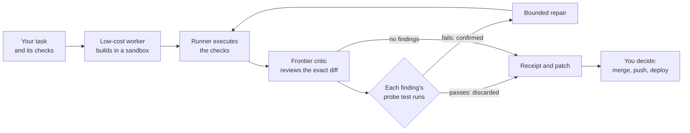

# How KLP Works

KLP Standard is one loop: a low-cost worker builds, the runner checks, an
independent critic reviews the exact result, and evidence settles every
finding. `klp run` does all of it in one command and ends with a patch and a
receipt.



## The six steps

1. **The worker builds.** A low-cost model with one tool, a shell, works in a
   private copy of your repository inside a sandbox with no network. It reads
   code, edits files and runs tests until it hands over, within a step limit.
2. **The runner executes your checks.** The commands you declared with
   `--check` run against the candidate. Their real exit codes and output go
   into the record. The worker's own account of what it ran is treated as a
   claim.
3. **The critic reviews the exact candidate.** A model from a different family
   reads one packet: the task, the diff with its enclosing functions, the check
   output and the project's own test rules. It judges whether the change
   delivers the task, keeps existing behaviour and follows the conventions of
   the surrounding code.
4. **Probes settle the findings.** Every blocking finding must come with a
   small test. The runner executes it against the candidate, under the
   project's own test configuration.
5. **Confirmed findings are repaired.** The worker gets each confirmed finding
   with its failing probe, fixes it, and the runner re-runs the checks and
   every open probe. The critic then reviews the repair.
6. **You get the result.** A patch, a receipt in plain English and JSON, and a
   ledger of every model call. Applying the patch is your decision.

## What happens to a finding

| The probe | The finding is | What follows |
| --- | --- | --- |
| fails on the candidate | `confirmed` | It goes to repair and stays open until its probe passes. |
| passes on the candidate | `refuted` | It is discarded. No repair is spent on it. |
| could not run | `unverified` | It is recorded and not acted on. |
| was not supplied, or the note is non-blocking | `advisory` | It is recorded for you to read. |

A critic can withdraw one of its own open findings when the worker shows the
task does not require it. Nothing else closes a confirmed finding.

In the feature benchmark's latest run this settled 80 blocking findings: 77
confirmed, 3 refuted, 70 fixed and verified before handover, and no repair
broke a task that had passed.

## How a run ends

| State | Meaning | Exit code |
| --- | --- | ---: |
| `completed` | Checks pass, and the review passed or its findings were fixed and reviewed again. | 0 |
| `budget_exhausted` | A cost, step, time or repair limit was reached with a finding or a check still open. The receipt lists each one with its failing probe. | 2 |
| `blocked` | A model or provider error stopped the run. Run it again when the provider is healthy. | 2 |
| `critical_trigger` | The change matches a critical trigger your project declared. It goes to the Critical path. | 2 |

## What the receipt holds

```text
# KLP Standard receipt: pallets_click-task2956-feature2

- protocol: klp-standard/v0.1, runner 0.5.0
- state: **completed**
- base snapshot: `7624d0355ce2...`
- final snapshot: `c707d6447180...`
- declared checks on final revision: passed
- worker: deepseek-flash
- critic: gpt-6.1-sol
- elapsed: 36.3s, cost: $0.0432

  - critic: 2 calls, 16,318 input tokens (0 cached), 918 output, $0.0418
  - repair: 3 calls, 203,651 input tokens (202,112 cached), 891 output, $0.0014

## Review 1: FAIL on `dc88d24cdcb3` (gpt-6.1-sol, profile eligible)
- [confirmed] F1: Adding validators before nargs in Parameter.__init__ breaks
  existing positional constructor calls ...

## Review 2: PASS on `c707d6447180` (gpt-6.1-sol, profile eligible)

## Repair 1: 1/1 confirmed findings closed, checks passed, kept

Still yours to decide: merge, push and deploy.
```

Every review is bound to the exact snapshot it judged. The same record is in
`receipt.json` with each probe's command and output, and `ledger.jsonl` has
one line per model call with its tokens, price tier and cost. All 66 receipts
of the benchmark's latest run are in
[the case study](../case-studies/feature-benchmark-2026-11-10/receipts/run-3).

## Why it costs less

- **The low-cost model does the volume.** It makes about 94% of the calls and
  reads over 96% of its input from cache.
- **The frontier model reads one packet per review.** About 15 KB, for one and
  a half cents.
- **Repairs are spent on demonstrated problems only.** A finding whose probe
  passes costs nothing further.
- **Limits are enforced.** Each task has a cost limit, a step limit, a repair
  limit and a time limit.

## What the runner enforces

- **Sandbox.** Worker commands, checks and probes run under bubblewrap with no
  network, a cleared environment and no view of your home directory or keys.
- **A record the worker cannot alter.** Candidates are snapshotted into a
  store the sandbox never mounts. The diff the critic reviews and the patch you
  apply come from that record.
- **Independence.** The runner refuses a critic from the worker's model family.
- **Your settings only.** Model routes, key names, limits and sandbox mounts
  come from your own config. A repository's `klp.json` can declare checks and
  critical triggers and nothing else.

Details are in [Safety and limits](../SAFETY_AND_LIMITS.md#standard-runner-boundaries).

## Standard and Critical

Standard is for ordinary bounded work, and it is what `klp run` and the
benchmarks use. Critical is for changes to saved data, security, money or a
protected core capability: it adds a capability gate that proves the product
still does its main job before and after the change. Declare your project's
critical triggers in `klp.json` and the critic checks every Standard change
against them. [Execution profiles](../EXECUTION_PROFILES.md) explains the
choice, and [PROTOCOL.md](../PROTOCOL.md) is the full Critical protocol.

## Several agents: Semio

When more than one agent works on a project, the Semiotic Protocol (Semio)
carries their coordination as short typed messages: who it is from, who it is
for, which task and which exact artifact. Because the message is structured,
software can settle the routine cases: a duplicate is dropped, a stale
revision is ignored, a finished piece of work is merged and tested, and a
model is woken only when there is a decision for it to make.

On 30 pairs of conflicting features this delivered the same 28 pairs as agents
coordinating by chat, with 333 model calls in place of 581 and one worker
woken where chat woke two.
[Paired-features study](../case-studies/paired-features-2026-11-10/README.md) ·
[Semio adapter](../adapters/semio.md)
